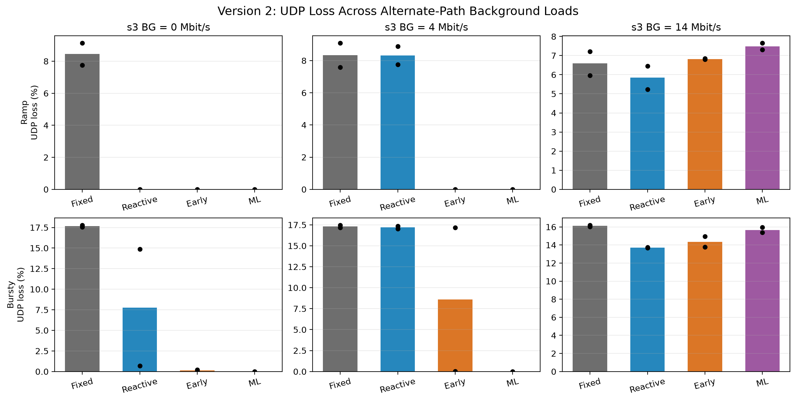
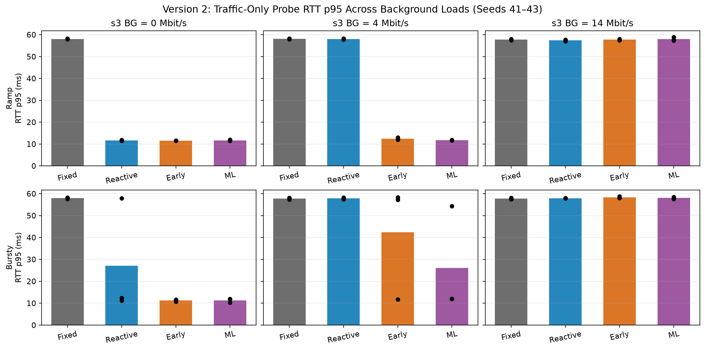
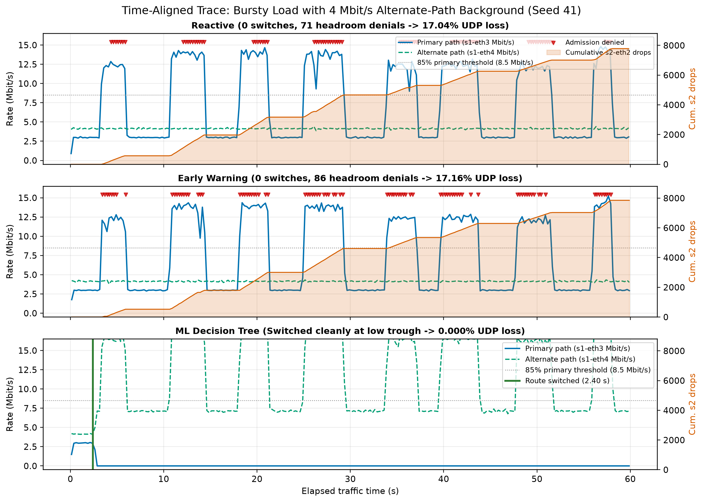

# Proactive Congestion Management in SDN Using a Decision Tree — Version 2 (`v2-busy-alternate`)

**Course:** CMPS342 Research Project — American University of Beirut (AUB)  
**Authors:** Youssef Shawwa & Jessy Karamaoun  
**Branch Role:** Clean modular **Version 2** extension (`86` completed matched & control trials under live alternate-path background traffic).  
> **Version 1 Preservation:** The `main` branch preserves the original, frozen, SHA-256-verified **Version 1** study (`36` matched idle-alternate trials + `6` held-out prediction runs) completely untouched. Version 1 (`1` vCPU, idle `s3`) and Version 2 (`2` vCPUs, active `h3 → h4` background on `s3`) are kept strictly separated for honest scientific reporting.

---

## 1. Why We Built Version 2

In **Version 1** (`main`), the 4-switch diamond topology connected `h1 ↔ h2` across a `10 Mbit/s` primary bottleneck (`s2-eth2`) and a `20 Mbit/s` alternate path (`s1-eth4 → s3-eth2`), while `h3` and `h4` sat idle (`0 Mbit/s` on `s3`). Although Version 1 proved that proactive triggering (`early_warning` and `ml`) strongly outperforms `reactive` rerouting under bursty load, it left **three major gaps** highlighted in Dr. Maurice Khabbaz's Progress Report 3 feedback:

1. **Asymmetric Path Sanity Check:** Because the `20 Mbit/s` alternate path (`s3`) was always empty in V1, permanently selecting `s3` would trivially eliminate congestion without needing dynamic rerouting. We needed to test a busy alternate path and run a **fixed-alternate control** to verify whether static alternate routing fails when `s3` carries competing traffic.
2. **Untested Stage 2 Admission Control Under Load:** The shared controller enforces a two-stage design:
   - **Stage 1 (Trigger):** `fixed`, `reactive`, `early_warning`, or frozen 15-node CART `ml` — inspecting **only** primary-path telemetry (`s1-eth3`, `s2-eth2`).
   - **Stage 2 (Admission Guard):** Checks live alternate-path background load (`s1-eth4`, `s3-eth2`) and admits a switch **only if**
     `selected_demand_bps + background_bps <= 0.8 × 15,900,000 = 12,720,000 bit/s (12.72 Mbit/s)`.
   In V1, `background_bps` was always `0`. We needed to test **moderate background load (`4 Mbit/s`, leaving `8.72 Mbit/s` headroom)** — where acting early determines whether a policy even *clears* admission — and **heavy background load (`14 Mbit/s`, `0 Mbit/s` safe headroom)** — where Stage 2 must **deny all switches** to protect background traffic.
3. **Full 3-Seed Repeatability, Low-Load Control, Timing/Trace Evidence & Modular Codebase:** Matching V1's 3 independent seeds (`41, 42, 43`), verifying low-load false-alarm behavior (`steady 3 Mbit/s`), extracting useful-warning timing, per-seed paired differences, a representative time-aligned trace, and a transparent retry/exclusion audit — all inside a clean modular folder structure while keeping **the exact frozen V1 Decision Tree (`config/selected_tree.json`, SHA-256 `63b8b320...`) and feature pipeline (`ml/build_trace_dataset.py`, SHA-256 `2654567a...`) byte-for-byte unchanged**.

---

## 2. What We Did Step by Step

### Step 1: Clean Modular Reorganization
We reorganized the flat V1 scripts into domain packages with clean package imports while keeping the frozen model and dataset feature code untouched:

```text
├── network/
│   ├── topology.py                   # 4-switch diamond topology (10M s2 primary, 20M s3 alternate)
│   ├── diamond_controller.py         # OS-Ken OF1.3 controller: h1<->h2 on SDN_PATH, h3<->h4 permanently on s3 (port 4)
│   ├── routing_action.py             # Shared Stage 2 Admission + OpenFlow1.3 priority-200 overlay for h1<->h2
│   ├── dual_path_profile.py          # Calibrates cburst=16384 & source limit=250 across all 8 links (incl. h3-eth0, s4-eth2)
│   └── experiment_config.py          # Route specifications & passive OpenFlow verification
├── traffic/
│   ├── continuous_udp.py             # Paced single-flow UDP generator/receiver (atomic JSON writes, inner-loop optimized)
│   ├── traffic_scenarios.py          # Deterministic steady, ramp, and bursty schedules by seed
│   └── run_continuous_trial.py       # Captures per-link tc queue drops, nstat UDP counters, vmstat, and endpoint summaries
├── telemetry/
│   ├── collect_path.py               # 250 ms root-namespace tc/sysfs collector covering primary & alternate queues
│   └── inspect_experiment.py         # Quality screens, queue summaries, and traffic-only ping RTT statistics
├── ml/
│   ├── build_trace_dataset.py        # Frozen causal 11-feature pipeline (SHA-256 verified against V1)
│   ├── tree_model.py                 # Pure-Python CART evaluator
│   └── ml_trigger.py                 # Loads & SHA-256-verifies frozen selected_tree.json at runtime
├── control/
│   ├── routing_policy.py             # Reactive & early-warning (trend forecast) triggers
│   ├── live_policy.py                # Shared causal online decision loop & admission builder
│   ├── run_policy_experiment.py      # Full single-trial orchestrator with optional h3->h4 bg_bps generator
│   ├── run_v2_batch.py               # Resumable 72-trial Williams-ordered batch runner (Seeds 41–43)
│   ├── run_steady_control.py         # Resumable 12-trial low-load steady 3 Mbit/s control runner
│   ├── run_fixed_alternate_control.py# 2-trial fixed-alternate control runner (SDN_PATH=alternate, bg=14M)
│   └── run_routing_smoke.py          # Quick OpenFlow smoke test
├── config/
│   ├── selected_tree.json            # Frozen V1 15-node CART tree (threshold 0.65, depth 3)
│   ├── operating_bounds.json         # Frozen admission budget (15.9 Mbit/s, 80% headroom = 12.72 Mbit/s)
│   └── dataset_protocol.json         # Frozen label protocol (85% util, 1s persistence, 2s horizon)
├── analysis/
│   ├── analyze_v2.py                 # Core summary table & UDP loss plot generator
│   └── build_v2_evidence.py          # Full evidence package: tables, paired diffs, timing, audit, 3 IEEE figures
└── results/
    ├── v2-batch.json                 # Complete 72-trial state + 8 logged retry attempts
    ├── v2-steady-control.json        # Complete 12-trial steady low-load state
    └── v2-report/                    # Publication-ready Markdown tables, CSVs, JSONs, and PNG plots
```

### Step 2: Activating Live `h3 → h4` Background Traffic on `s3`
- **`network/diamond_controller.py`:** Routed `h3 ↔ h4` permanently onto `s3` (`port 4` on `s1` and `s4`), while `h1 ↔ h2` uses `SDN_PATH` (`primary` = port 3, `alternate` = port 4).
- **`network/routing_action.py`:** Updated `BASE_PORTS` signatures to match `h3 ↔ h4` on port 4 while keeping the high-priority (`priority=200`) OpenFlow overlay restricted strictly to `h1 ↔ h2` (`10.0.0.1 ↔ 10.0.0.2`).
- **`network/dual_path_profile.py`:** Extended calibration (`cburst 16384`, `limit 250` on senders) to `h3-eth0` and `s4-eth2` so `h3 → h4` never suffers artificial sender-side qdisc drops.
- **`control/run_policy_experiment.py`:** Added configurable `bg_bps` launching a live `h3 → h4` UDP stream across `s3` during each trial and recording `bg-sender.json` / `bg-receiver.json` to measure background-flow protection (`bg_loss_percent`).

### Step 3: Systematic Platform Debugging & Engineering Fixes Before Data Collection
Every systems issue encountered on the Ubuntu VirtualBox VM (`joe-vm`) was diagnosed with `vmstat`, `nstat`, and raw logs before accepting any batch data:
1. **1-vCPU Starvation Diagnosed & Fixed:** Initial `bg_bps = 14 Mbit/s` tests on `1` vCPU with `iperf3 -u` hit `0%` idle CPU (`us 40%, sy 60%`), producing `68.5%` UDP loss, `8+ s` RTT, and `0` drops at `s2-eth2`. We upgraded the VM to **`2` vCPUs** (`12–28%` idle CPU at peak load) and replaced `iperf3 -u` (which busy-spins) with paced `traffic/continuous_udp.py`, immediately restoring localized `s2-eth2` drops (`~5,676`), `~10.6%` loss, and `58.1 ms` p95 RTT.
2. **2-vCPU Startup Race Condition Fixed Atomically:** Under 2 vCPUs, `run_continuous_trial.py` occasionally read `receiver-ready.json` the microsecond it was created before JSON bytes finished flushing (`JSONDecodeError`). We made `save_json()` in `traffic/continuous_udp.py` atomic (`write .tmp` → `replace`), permanently eliminating startup races.
3. **Dual-Flow Burst Pacing Optimization (`27.8 Mbit/s` combined peak):** At `bursty` peaks (`13.8 Mbit/s`) + `14 Mbit/s` background, `h1` initially fell ~1–2% below the 5% `achieved_sender_rate` screen. We lowered background generator priority (`nice -n 19`, `--payload-bytes 1470`, `--tick 0.01`, reducing background packets/sec by 18.4% at the same bit rate), gave primary `h1`/`h2` higher priority (`nice -n -10`), and hoisted constant `bytes.fromhex()` / padding allocations out of the per-packet loop in `continuous_udp.py` (sending bit-for-bit identical payloads).
4. **Windows Host Power Throttling Caught & Resolved:** During Seed 43, `collector_cpu` spiked from `~9%` to `13.25%` due to host power management. Switching the Windows host to plugged-in **Best Performance** dropped `collector_cpu` to `4.3–7.4%`, and all 24 Seed 43 trials + 12 steady trials completed with `screen_failures: []` and `0` invalid intervals.

---

## 3. Experiments & What Happened After Each One (`86` Clean Trials Total)

### Experiment 1 — Fixed-Alternate Control Check (`2` Trials, `s3 BG = 14 Mbit/s`, Seed 41)
**Question (Dr. Khabbaz):** *Does permanently selecting the `20 Mbit/s` alternate path (`s3`) already solve the problem?*  
We started OS-Ken with `SDN_PATH=alternate` and ran `control/run_fixed_alternate_control.py` so `h1 → h2` shared `s3` permanently with `14 Mbit/s` `h3 → h4` background traffic.

| Scenario | Seed | `h1→h2` Goodput (Mbit/s) | `h1→h2` Loss (%) | RTT `p95` (ms) | `s1-eth4` Drops | `s3-eth2` Drops | `h3→h4` BG Goodput (Mbit/s) | `h3→h4` BG Loss (%) |
| --- | ---: | ---: | ---: | ---: | ---: | ---: | ---: | ---: |
| `ramp` | 41 | 6.972 | **14.264%** | 42.4 | **14,889** | 0 | 12.157 | **10.354%** |
| `bursty` | 41 | 5.795 | **17.952%** | 36.8 | **15,555** | 0 | 12.362 | **10.220%** |

**What Happened:** Permanently routing onto `s3` **failed catastrophically for BOTH flows** (`screen_failures: []` on both runs):
- `h1 → h2` suffered **worse** loss (`14.26%` ramp / `17.95%` bursty) and lower goodput (`6.97` / `5.80 Mbit/s`) than staying on the `10 Mbit/s` primary path (`~7.51` / `~6.05 Mbit/s`).
- `s1-eth4` suffered **`14,889–15,555` queue drops**, inflicting **`10.22–10.35%` packet loss** on the innocent `h3 → h4` background flow.  
**Conclusion:** Permanently selecting the alternate path is **not** viable when `s3` is busy; dynamic Stage 2 admission control is genuinely required. *(Full report: [`FIXED_ALTERNATE_CONTROL.md`](results/v2-report/FIXED_ALTERNATE_CONTROL.md))*

---

### Experiment 2 — Main 3-Seed Matched Policy Evaluation (`72` Trials: 4 Policies × 2 Scenarios × 3 `s3` BG Loads × Seeds 41–43)
Using Williams-rotated policy ordering in `control/run_v2_batch.py` (`11.5 Mbit/s` scale, `60 s` per trial), we evaluated `fixed`, `reactive`, `early_warning`, and `ml` across `s3 BG = 0, 4, 14 Mbit/s`.

| Scenario | `s3` BG (Mbit/s) | Policy | Goodput mean [range] (Mbit/s) | UDP Loss mean [range] (%) | RTT `p95` mean [range] (ms) | Switches | Total Denials | `s2` Drops | `s3` Drops | BG Loss (%) |
| --- | ---: | --- | --- | --- | --- | ---: | ---: | ---: | ---: | ---: |
| ramp | 0 | `fixed` | 7.512 [7.492, 7.526] | 9.642 [7.750, 12.038] | 58.1 [57.9, 58.2] | 0/3 | 0 | 15,135 | 0 | 0.000 |
| ramp | 0 | `reactive` | 8.324 [8.158, 8.567] | **0.000** [0.000, 0.000] | 11.7 [11.4, 11.9] | 3/3 | 0 | 0 | 0 | 0.000 |
| ramp | 0 | `early_warning` | 8.327 [8.159, 8.576] | **0.000** [0.000, 0.000] | 11.5 [11.5, 11.6] | 3/3 | 0 | 0 | 0 | 0.000 |
| ramp | 0 | `ml` | 8.329 [8.157, 8.584] | **0.000** [0.000, 0.000] | 11.7 [11.4, 12.0] | 3/3 | 0 | 0 | 0 | 0.000 |
| ramp | **4** | `fixed` | 7.514 [7.492, 7.526] | 9.573 [7.586, 12.039] | 58.1 [57.9, 58.2] | 0/3 | 0 | 15,016 | 0 | 0.000 |
| ramp | **4** | `reactive` | 7.511 [7.490, 7.525] | **8.893** [7.748, 10.052] | 58.0 [57.8, 58.2] | **0/3** | **334** | 13,804 | 0 | 0.000 |
| ramp | **4** | `early_warning` | **8.292** [8.157, 8.479] | **0.000** [0.000, 0.000] | **12.4** [12.0, 13.0] | **3/3** | 0 | **0** | 0 | **0.000** |
| ramp | **4** | `ml` | **8.317** [8.157, 8.564] | **0.000** [0.000, 0.000] | **11.8** [11.7, 11.9] | **3/3** | 0 | **0** | 0 | **0.000** |
| ramp | 14 | `fixed` | 7.510 [7.490, 7.521] | 8.516 [5.962, 12.375] | 57.8 [57.5, 58.0] | 0/3 | 0 | 13,295 | 0 | 0.005 |
| ramp | 14 | `reactive` | 7.508 [7.482, 7.524] | 7.995 [5.227, 12.303] | 57.5 [57.0, 57.7] | **0/3** | **298** | 12,461 | 20 | 0.027 |
| ramp | 14 | `early_warning` | 7.512 [7.488, 7.525] | 8.669 [6.794, 12.364] | 57.8 [57.5, 58.0] | **0/3** | **213** | 13,538 | 0 | 0.036 |
| ramp | 14 | `ml` | 7.506 [7.478, 7.524] | 9.108 [7.309, 12.357] | 58.0 [57.4, 58.9] | **0/3** | **96** | 14,265 | 0 | 0.014 |
| bursty | 0 | `fixed` | 6.127 [5.820, 6.517] | 18.568 [17.554, 20.366] | 58.0 [57.6, 58.2] | 0/3 | 0 | 26,418 | 0 | 0.000 |
| bursty | 0 | `reactive` | 7.152 [6.013, 8.136] | 5.404 [0.668, 14.862] | 27.2 [11.2, 57.9] | 3/3 | 39 | 7,233 | 0 | 0.000 |
| bursty | 0 | `early_warning` | 7.532 [7.052, 8.190] | 0.093 [0.014, 0.197] | 11.3 [10.7, 11.6] | 3/3 | 0 | 126 | 0 | 0.000 |
| bursty | 0 | `ml` | **7.539** [7.068, 8.191] | **0.000** [0.000, 0.000] | **11.3** [10.3, 11.9] | 3/3 | 0 | **0** | 0 | 0.000 |
| bursty | **4** | `fixed` | 6.128 [5.817, 6.518] | 18.327 [17.158, 20.360] | 57.8 [57.3, 58.1] | 0/3 | 0 | 26,009 | 0 | 0.000 |
| bursty | **4** | `reactive` | 6.129 [5.821, 6.518] | **18.246** [17.040, 20.362] | 57.9 [57.5, 58.2] | **0/3** | **207** | 25,882 | 0 | 0.000 |
| bursty | **4** | `early_warning` | 6.781 [6.049, 7.242] | **9.564** [0.014, 17.163] | 42.4 [11.7, 58.3] | **2/3** | **143** | 13,765 | 0 | 0.000 |
| bursty | **4** | **`ml`** | **7.485** [7.064, 8.047] | **0.587** [0.000, 1.762] | **26.1** [11.9, 54.3] | **3/3** | **3** | **903** | **0** | **0.000** |
| bursty | 14 | `fixed` | 6.131 [5.823, 6.517] | 17.530 [16.030, 20.363] | 57.8 [57.5, 58.1] | 0/3 | 0 | 24,746 | 0 | 0.000 |
| bursty | 14 | `reactive` | 6.134 [5.829, 6.519] | 15.719 [13.686, 19.713] | 57.9 [57.9, 58.0] | **0/3** | **206** | 21,889 | 0 | 0.006 |
| bursty | 14 | `early_warning` | 6.129 [5.829, 6.518] | 16.327 [13.771, 20.265] | 58.3 [58.0, 58.8] | **0/3** | **260** | 22,880 | 0 | 0.000 |
| bursty | 14 | `ml` | 6.130 [5.827, 6.518] | 17.219 [15.382, 20.317] | 58.1 [57.6, 58.5] | **0/3** | **262** | 24,251 | 0 | 0.000 |





**What Happened Across the Three Regimes:**
1. **`s3 BG = 0 Mbit/s` (Idle Alternate — Reproduces V1):** All three dynamic policies achieve `0.000%` loss on `ramp`; on `bursty`, `ml` (`0.000%`, `0` drops) and `early_warning` (`0.093%`, `126` drops) decisively beat `reactive` (`5.404%`, `39` denials) and `fixed` (`18.568%`).
2. **`s3 BG = 4 Mbit/s` (Tight `8.72 Mbit/s` Remaining Headroom — Headline V2 Discovery):**
   - **`ramp`:** `reactive` waited until demand exceeded `8.72 Mbit/s`, got **denied 334 times (`0/3` switches)**, and degraded to `8.893%` loss (`58.0 ms` p95 RTT) — virtually identical to `fixed` (`9.573%`). Both proactive policies (`early_warning` and `ml`) triggered early enough to clear admission (`3/3` switches, **`0.000%` loss**, `~12 ms` p95 RTT, `0.000%` BG loss).
   - **`bursty`:** `reactive` failed **0/3** (`18.246%` loss, `207` denials). `early_warning` succeeded **2/3** (`9.564%` mean loss, `143` denials — blocked completely on Seed 41 at `17.163%`, switched late on Seed 43 at `11.516%`, clean on Seed 42 at `0.014%`). **`ml` achieved `3/3` switches and `0.587%` mean loss (only `3` denials, `0.000%` BG loss)** — **outperforming `early_warning` on all 3 independent seeds** (`−17.163 pp` Seed 41, `−0.014 pp` Seed 42, `−9.754 pp` Seed 43; full table in [`V2_PAIRED_DIFFERENCES.md`](results/v2-report/V2_PAIRED_DIFFERENCES.md)).
3. **`s3 BG = 14 Mbit/s` (Safety-Guard Stress Test):** Stage 2 Admission Control blocked **100% of switch attempts (`0/24` applied, `1,335` denials)** across all policies and seeds, protecting `h3 → h4` background traffic at **`≤ 0.036%` loss** (compared to `~10.3%` loss under Fixed-Alternate!). *Note:* Receiver goodput is identical across all four policies at `14 Mbit/s` (`7.51 Mbit/s` ramp, `6.13 Mbit/s` bursty); minor `1–2%` variations in UDP loss % reflect `±3%` sender pacing variation under dual-flow 2-vCPU load rather than policy differences, since no switches occurred.

---

### Experiment 3 — Low-Load `steady 3 Mbit/s` Control (`12` Trials, `s3 BG = 4 Mbit/s`, Seeds 41–43)
**Question (Dr. Khabbaz):** *Does `ml` trigger unnecessary switches under steady low load?*  
Ran `control/run_steady_control.py` across all 4 policies and 3 seeds (`41–43`) at `3 Mbit/s` primary + `4 Mbit/s` background on `s3` (where an unnecessary switch would pass admission since `3 + 4 = 7 ≤ 12.72 Mbit/s`).

| Policy | Goodput mean (Mbit/s) | UDP Loss mean (%) | RTT `p95` mean (ms) | Unnecessary Switches | Denials | BG Loss (%) |
| --- | ---: | ---: | ---: | ---: | ---: | ---: |
| `fixed` | 3.000 | 0.000 | 10.8 | **0/3** | 0 | 0.000 |
| `reactive` | 3.000 | 0.000 | 10.8 | **0/3** | 0 | 0.000 |
| `early_warning` | 3.000 | 0.000 | 10.4 | **0/3** | 0 | 0.000 |
| `ml` | 3.000 | 0.000 | 10.6 | **0/3** | 0 | 0.000 |

**What Happened:** All **12/12** trials passed with `screen_failures: []`, `0.000%` loss, `0.000%` BG loss, and **`0/3` unnecessary switches** for every policy — including `ml` across 694 tree evaluations (`33–41 µs` median CPU). *(Full report: [`V2_STEADY_CONTROL.md`](results/v2-report/V2_STEADY_CONTROL.md))*

---

### Experiment 4 — Switch Timing, Useful Warning, Control Overhead & Time-Aligned Trace
Extracted directly from the 72 completed runs' `policy.json`, `decisions.jsonl`, `samples.jsonl`, and `sender-native.json` via `analysis/build_v2_evidence.py`:

| Policy | Applied Switches | Zero-Drop Switches | Mean Trigger Time (s) | Mean Demand at Switch (Mbit/s) | Mean Switch + Readback (s) | Collector CPU (%) | Policy Thread CPU (%) |
| --- | ---: | ---: | ---: | ---: | ---: | ---: | ---: |
| `fixed` | 0 | 0/0 | n/a | n/a | n/a | 8.79 | 2.81 |
| `reactive` | 6 | 3/6 | 16.59 | 10.81 | 0.174 | 8.85 | 3.44 |
| `early_warning` | 11 | 6/11 | 10.87 | 8.34 | 0.171 | 9.05 | 3.19 |
| **`ml`** | **12** | **11/12** | **7.41** | **5.39** | **0.167** | **8.66** | **3.03** |

- **Observation-to-action age (`started − observed_at`):** mean **`0.164 s`** `[0.084, 0.221]` across all 29 switches.
- **OpenFlow modify + readback latency:** mean **`0.170 s`** `[0.080, 0.280]`.
- **ML Inference CPU Cost (15-node CART across 18 ML trials):** median **`53.8 µs`** `[33.1–65.9 µs]`, p95 **`138.9 µs`** (max `872.0 µs`, `< 0.03%` of one CPU core).



**What the Trace Shows (`bursty`, `s3 BG = 4 Mbit/s`, Seed 41):**  
On sudden `2.3 → 13.8 Mbit/s` bursts, `reactive` (71 denials) and `early_warning` (86 denials) fire *after* demand already exceeds the `8.72 Mbit/s` remaining headroom, so Stage 2 denies every burst and `s2-eth2` accumulates `~7,800` drops (`~17.1%` loss). The Decision Tree (`ml`) triggers at **`t = 2.40 s`** during the initial low-rate trough (`3.04 + 4.15 = 7.19 ≤ 12.72 Mbit/s`), completing the OpenFlow switch before the first burst arrives and sustaining **`0` drops (`0.000%` loss)** for the full 60 seconds. *(Full report: [`V2_TIMING_AND_OVERHEAD.md`](results/v2-report/V2_TIMING_AND_OVERHEAD.md))*

---

### Experiment 5 — Data Quality, Exclusion & Retry Audit
No runs were silently discarded. Every retried attempt is logged in `results/v2-batch.json` and audited in [`V2_EXCLUSION_AUDIT.md`](results/v2-report/V2_EXCLUSION_AUDIT.md):
- **Main matched batch:** `72/72` accepted (`69/72` with `0` invalid collector intervals; `3/72` at `14 Mbit/s` with `1–2` skipped 250 ms ticks out of ~266 and `0` failed queries). **8** failed attempts were retried and logged (1 startup JSON race fixed atomically, 3 `bursty+14M` pacing shortfalls before inner-loop optimization, 2 transient `udp_error` retries, and 2 `ramp+14M` Seed 43 shortfalls before enabling Windows Best Performance mode).
- **Steady low-load control:** `12/12` accepted (`0` retries, `0` screen failures).
- **Fixed-alternate control:** `2/2` clean (`screen_failures: []`).

---

## 4. Key Conclusions & Honest Limitations

1. **Proactive Timing Unlocks Admission Control Under Busy Alternate Paths:** When `s3` carries moderate background traffic (`4 Mbit/s`), acting early is no longer just about avoiding brief queue buildup — it determines whether Stage 2 admits the switch at all. `reactive` failed `0/6` times across both `ramp` and `bursty` (`334 + 207 = 541` denials).
2. **ML Outperforms `early_warning` Under Bursty Load + Tight Headroom (`0.59%` vs `9.56%`):** Across all 3 independent seeds at `bursty + 4 Mbit/s`, the 15-node Decision Tree achieved `3/3` switches (`11/12` zero-drop switches overall) at `53.8 µs` median CPU overhead, cutting mean UDP loss by **16×** vs `early_warning` and **31×** vs `reactive` with `0.000%` harm to `h3 → h4`.
3. **Honest Nuance on the ML Advantage:** The frozen V1 tree achieves its early burst switch via its root split (`upstream_mean_1s <= 3.024 Mbit/s`), which fires on low-rate burst troughs. While V2 observed **`0/3` steady-load false switches** on the smoother 2-vCPU platform, V1 observed `1/3` unnecessary switches on 1-vCPU steady `3 Mbit/s` traffic. Retraining the tree with `steady` low-load negative traces is therefore recommended in future work to preserve burst responsiveness without low-load threshold sensitivity.
4. **Scope Boundaries:** Results come from a 4-switch emulated Mininet/OVS topology with paced UDP flows (no TCP congestion control feedback) and one-way route switching; V1 (`1` vCPU) and V2 (`2` vCPUs) are reported separately and never pooled.

---

## 5. How to Reproduce Version 2 (Ubuntu Linux + Mininet + OS-Ken)

### Environment Setup
```bash
python3 -m venv .venv
.venv/bin/pip install -r requirements.txt matplotlib
```

### Run Main 72-Trial Batch (`SDN_PATH=primary`)
- **Terminal A (Controller):**
  ```bash
  SDN_PATH=primary .venv/bin/osken-manager --ofp-tcp-listen-port 6653 network/diamond_controller.py
  ```
- **Terminal B (Mininet):**
  ```bash
  sudo mn -c
  sudo mn --custom network/topology.py --topo diamond --link tc --arp \
    --controller remote,ip=127.0.0.1,port=6653 \
    --switch ovs,protocols=OpenFlow13 --wait
  ```
  At `mininet>`:
  ```text
  pingall
  py exec(compile(open('control/run_v2_batch.py').read(), 'control/run_v2_batch.py', 'exec'), {'net': net, '__file__': 'control/run_v2_batch.py', 'limit': 24})
  py exec(compile(open('control/run_steady_control.py').read(), 'control/run_steady_control.py', 'exec'), {'net': net, '__file__': 'control/run_steady_control.py'})
  ```

### Run Fixed-Alternate Control (`SDN_PATH=alternate`)
Start Terminal A with `SDN_PATH=alternate`, start Mininet in Terminal B, and run:
```text
py exec(compile(open('control/run_fixed_alternate_control.py').read(), 'control/run_fixed_alternate_control.py', 'exec'), {'net': net, '__file__': 'control/run_fixed_alternate_control.py'})
```

### Regenerate All Tables & Figures
```bash
.venv/bin/python analysis/build_v2_evidence.py
```

---

## 6. Generated Evidence Artifacts (`results/v2-report/`)

| File | Description |
| :--- | :--- |
| [`V2_RESULTS.md`](results/v2-report/V2_RESULTS.md) | 72-trial 3-seed summary table (goodput, UDP loss, RTT p95, switches, denials, drops, BG loss) |
| [`v2_trials.csv`](results/v2-report/v2_trials.csv) | Complete per-trial dataset for all 72 main trials |
| [`FIXED_ALTERNATE_CONTROL.md`](results/v2-report/FIXED_ALTERNATE_CONTROL.md) | 2-trial fixed-alternate control table proving static `s3` overloads both flows at `14 Mbit/s` |
| [`V2_STEADY_CONTROL.md`](results/v2-report/V2_STEADY_CONTROL.md) | 12-trial steady `3 Mbit/s` low-load control table (`0/3` unnecessary switches for all policies) |
| [`V2_TIMING_AND_OVERHEAD.md`](results/v2-report/V2_TIMING_AND_OVERHEAD.md) & [`v2_timing.csv`](results/v2-report/v2_timing.csv) | Observation age, trigger time, OpenFlow switch+readback latency, zero-drop rate, CPU & ML `µs` latency |
| [`V2_PAIRED_DIFFERENCES.md`](results/v2-report/V2_PAIRED_DIFFERENCES.md) | Individual per-seed paired differences (`ml − early`, `early − reactive`, `ml − reactive`) across Seeds 41–43 |
| [`V2_EXCLUSION_AUDIT.md`](results/v2-report/V2_EXCLUSION_AUDIT.md) | Transparent retry & collector quality audit across all 86 accepted trials + 8 logged retries |
| [`v2_udp_loss.png`](results/v2-report/v2_udp_loss.png) | 6-panel UDP loss figure across `0 / 4 / 14 Mbit/s` × `ramp / bursty` (Seeds 41–43) |
| [`v2_rtt_p95.png`](results/v2-report/v2_rtt_p95.png) | 6-panel traffic-only probe RTT p95 companion figure (Seeds 41–43) |
| [`v2_trace_bursty_4m_seed41.png`](results/v2-report/v2_trace_bursty_4m_seed41.png) | 3-panel time-aligned trace (`reactive` vs `early_warning` vs `ml`, `bursty`, `bg = 4 Mbit/s`, Seed 41) |
