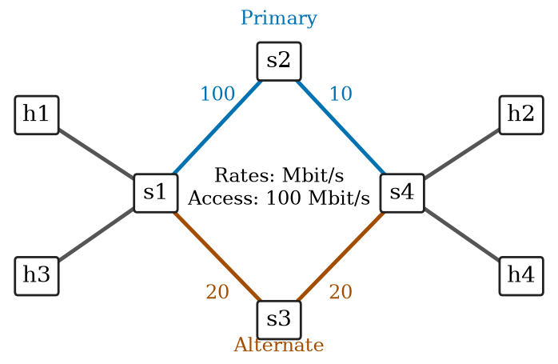
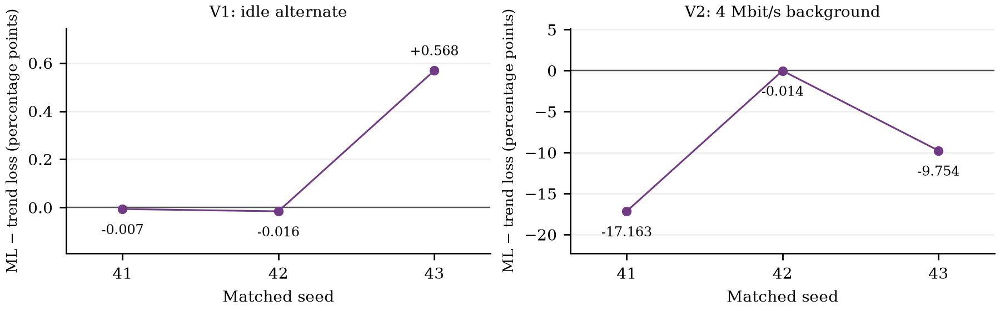
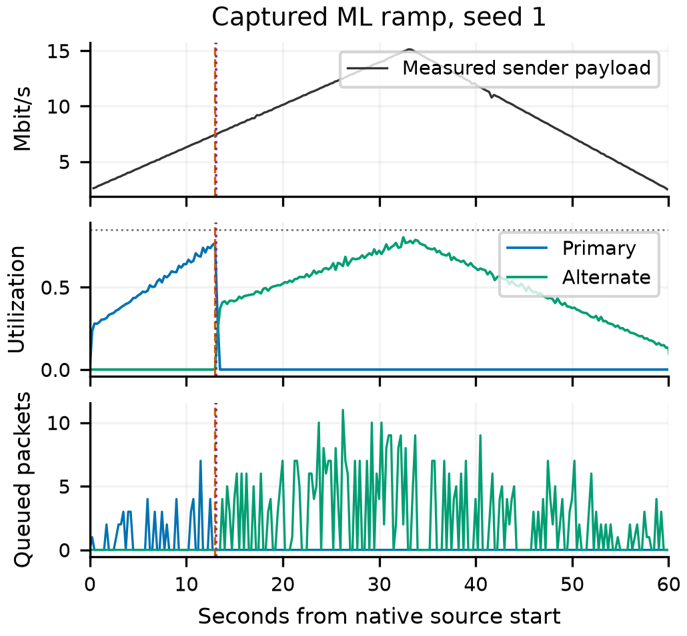
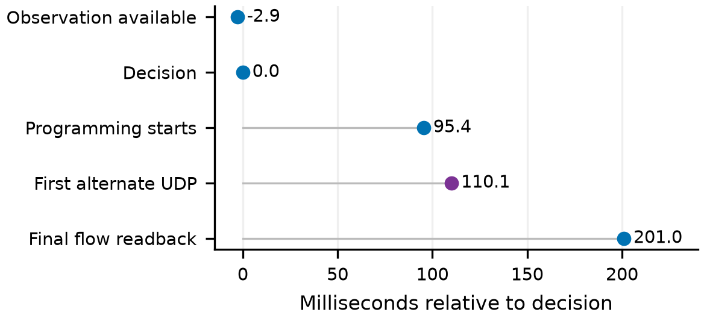

# Final paper figures and tables

These are code-generated assets for the combined paper. No image-generation
model is used. [Rebuild and audit instructions](../../docs/PAPER_ASSETS.md).
The private manuscript stays outside GitHub.

```bash
python -m pip install -r requirements-analysis.txt
python reproduce.py --output scratch/paper-audit --figures
```

## Figures

### Figure 1 — Topology from the frozen Mininet source



[PDF](figures/01-topology.pdf) · [Configuration data](plot-data/topology.csv) ·
[Generator](../../analysis/build_paper_assets.py).
This is a code-derived schematic, not a measurement.

### Figure 2 — Individual matched loss differences



[PDF](figures/02-paired-differences.pdf) · [Exact values and run IDs](plot-data/paired-differences.csv) ·
[Generator](../../analysis/build_paper_assets.py).
V1 and V2 are separate cohorts; panel scales differ. V2 original raw logs are
unavailable, so its values are reproduced from pinned trial summaries.

### Figure 3 — Actual captured ML ramp



[PDF](figures/03-aligned-captured-trace.pdf) · [Sender series](plot-data/captured-source.csv) ·
[Queue/counter series](plot-data/captured-queues.csv) ·
[Event markers](plot-data/capture-events.json) · [Generator](../../analysis/plot_paper_evidence.py).
The V1 raw capture, clock samples and traffic records are in the compact input package.

### Figure 4 — Distinct observed control timestamps



[PDF](figures/04-forwarding-timing.pdf) · [Exact values and clock interval](plot-data/forwarding-timing.csv) ·
[Generator](../../analysis/plot_paper_evidence.py).
Software egress observation is not receiver delivery or atomic installation.

## Tables

All cells are generated by [build_paper_assets.py](../../analysis/build_paper_assets.py).

| Paper table | CSV | Evidence |
| --- | --- | --- |
| I Settings | [parameters](tables/parameters.csv) | Frozen configuration and actual code defaults; not empirical outcomes |
| II Dataset accounting | [dataset](tables/dataset.csv) | V1 raw-backed partition/exclusion replay |
| III Path validation | [validation](tables/validation.csv) | Actual V1 matched/steady/variable control measurements |
| IV Networking | [network](tables/network.csv) | Means of original V1 matched runs |
| V Prediction | [prediction](tables/prediction.csv) | Frozen-model scores on untouched no-intervention traces |
| VI V2 loss | [v2loss](tables/v2loss.csv) | Means of retained reported V2 trial summaries |

[Readable tables](tables.md) · [Manuscript table data](table-data.json) ·
[Unrounded cells, calculations and run IDs](table-provenance.json).

## Audit inputs and outputs

- [Complete source map and hashes](provenance.json).
- [Successful complete rebuild receipt](rebuild-verification.json).
- [Published file checksums](SHA256SUMS.json).
- [V2 per-trial summary records](v2-trials.csv), [full-precision aggregates](v2-aggregates.csv),
  [control summaries](v2-controls.csv), and [eight logged failed/retried attempts](v2-failed-attempts.csv).
- [Original V2 inputs and immutable origin](../../data/v2/manifest.json).
- [Original V1 evidence package index](../../data/manifest.json).

Display rounding does not alter the full-precision source values. RTT entries
are means of within-run probe p95 values; they are not a pooled packet percentile.
The V2 results retain three recorded collector-quality exceptions and do not
claim independent raw inspection of its missing original logs.
